# 下一代单体智能：架构可行性探讨

> 技术备忘录 · 采用 [CC BY-NC-SA 4.0](LICENSE) 许可
>
> 本文基于公开研究进展整理，部分产品化数据为厂商自报；前沿方向演进迅速，请以最新一手文献为准。由 AI 辅助整理、人工审校。

## 摘要

下一代单体智能（Monolithic Intelligence）指一种自包含的、有边界、能持续存在的智能体，而非当前由"无状态模型 + 向量库 + 编排器 + 工具"拼装而成的多体管线。本备忘录系统梳理其架构可行性与 2025–2026 年的关键突破，核心结论如下：

第一，单体智能的"外壳"——有状态单实例、内化记忆、内部检索——在工程上已能拼出可用原型；但"灵魂"——持续可写记忆、自我巩固、持续学习而不灾难性遗忘——仍处于科学研究与工程突破的前沿。

第二，标准 Transformer 架构能满足"推理引擎"的需求，但满足不了"单体智能整体架构"的需求：其无状态、参数只读、O(n²)、缺乏结构化记忆与显式因果等结构性约束，正是"灵魂缺失"的架构根源。要让记忆像人脑一样被及时更新与存储，必须引入可写状态（SSM 混合、记忆网络、可塑权重或其统一形态）。

第三，2025–2026 年，可写状态方向出现了实质性进展，且三者正在汇流于 Test-Time Training（TTT）这一统一框架：SSM 已产品化，记忆网络经 Titans 复兴，可塑权重研究活跃；TTT 把"模型在运行时通过梯度/Hebbian 规则更新内部状态"首次做成可实证的方向，是当下最值得押注的突破口。

第四，单体智能须同时具备"感知并发与即时记忆"的入口能力，以及"从低级大脑逐步自我进化"的发育能力。前者要求并行异步的感知缓冲与易失即时记忆层；后者要求预装"最小学习规则集"而非知识，并以互补学习系统（CLS）的双系统结构（暂存层 + 稳固层 + 离线巩固）化解稳定性–可塑性困境。该困境在 TTT/Titans 架构上已有清晰的落地切口。

第五，上述架构最终必须落到物理载体。单体智能与当前 GPU 主导范式存在结构性错配：它不是"CPU 还是 GPU"的二选一，而是按负载分层的异构底座——CPU 主管状态与记忆、专用低延迟芯片负责联想、FPGA 承载"每步可写"的状态与在线更新、离线巩固则是唯一天然适配 GPU 的一环。2026 年首个 Gated DeltaNet（TTT 家族特例）FPGA 解码加速器已给出 63 μs/token、较 H100 快 4.5 倍、能效高 60 倍的实证起点，为"权重可写 + 状态常驻"的新硬件契约提供了首个可验证支点。

第六，单体智能还缺两块拼图，却在近年同时成熟：**具身**把前述所有类比放进了物理世界的硬约束之中——控制回路 100Hz 至 1kHz 的延迟要求、形态本身作为"不会被灾难性遗忘的稳固层"、物理世界提供的不可伪造奖励信号，使具身很可能成为单体智能最先落地的形态；**世界模型**则补上了第三章"内部思维与模拟"那一路的工程实体——它让智能体从被动反应转向主动反事实推演。由此还引出自我问题的关键判断：自我不是独立模块，**自我描述是世界模型把建模能力转向自身的结果**；身体我依赖前向模型产生的主体感，经验我依赖情景记忆，叙事我还依赖"他人模型"——三层自我都需要世界模型的支撑。JEPA 路线（在抽象表征空间预测，而非逐像素渲染）与 TTT 运行时可写机制的结合，第一次让"脑内模拟 + 持续自更新"有了完整的工程轮廓。

第七，全篇在摘要后给出**架构总览**：把全部论证压成一张六层架构图（感知入口 / 状态与记忆 / 主干联想 / 世界与自体 / 发育与对齐 / 硬件载体），每层并列核心机制与可行落地技术，并按“货架级 / 研究级 / 开放”三档标注成熟度；在结论前给出**贯穿案例**——以“手指被蒸汽烫一下”为例，展示五根支柱与三层时间尺度如何在一次日常事件中完整跑通，并点明“一次学习”的本质是**先验压缩的爆发**而非样本效率奇迹。

## 总览：下一代个体智能六层架构与可行落地技术

在展开逐章论证前，先给出全篇的架构总图作为阅读导航。系统按信息流与时间尺度自下而上组织为六层：从毫秒级的感知入口，到秒至天级的状态记忆、逐 token 的主干联想，再到面向未来的世界与自体、贯穿终身的发育与对齐，最终落到异构硬件载体。每层并列给出核心机制链与目前可行的落地技术；图中技术标签按成熟度分三档，见后文说明。

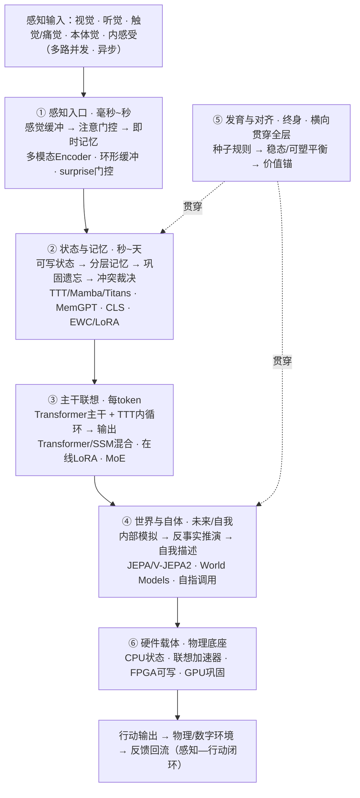

*图 0.1 六层架构总图：纵向为信息流与时间尺度，横向并列核心机制与可行落地技术；⑤发育与对齐横向贯穿所有层*

### 技术成熟度的三档分布

图中的技术标签并非同一成色，读懂"哪档能用"是这张图的关键：

| 成熟度 | 涵盖技术 | 可做什么 |
| --- | --- | --- |
| 货架级（今天可落地） | 多模态 Encoder、环形缓冲、MemGPT / Letta、Zep / Mem0、EWC / LoRA、Transformer/SSM 混合、CPU+大内存、GPU 离线、LPU 推理 | 拼出有状态、可检索、能外挂记忆的原型 Agent |
| 研究级（原型可用） | Titans / TTT、CLS 双系统、裁决状态机、在线 LoRA、GDN FPGA 加速器、V-JEPA 2、World Models、内在动机、可塑性衰减 | 验证"运行时可写 + 带遗忘"与脑内模拟的关键机制 |
| 开放（仍未解） | 参数级持续学习不遗忘、每 token 改权重的大规模验证、自指自我与校准型元认知、真正的自主发育、自洽价值锚、单芯片同时满足四条硬件契约 | 尚无成熟解，正是"魂未至"的部分 |

### 三条贯穿全图的主线

**其一，时间尺度分层是架构的组织原则**。毫秒级（感知/反射）、秒至天级（写入/巩固）、终身级（发育/对齐）各走各的路径——这解释了为何不能靠单一模型包打天下：在线要低延迟单流，离线要高吞吐批处理，两者对硬件的要求正好相反（第十章"离线巩固是唯一天然适配 GPU 的一环"）。

**其二，"可写状态"是承上启下的枢纽**。它上接感知写入、下接记忆巩固，也是唯一同时卡在算法（TTT）与硬件（FPGA）两端的层——这正是"所有路最后都汇到这一块"的原因。

**其三，⑤发育与对齐不是纵向的一站，而是横向切过所有层的约束**。种子规则决定②能写什么，稳定性–可塑性决定③如何更新，价值锚决定②的冲突裁决谁胜出，escalation 是最后的安全阀。

> 诚实边界：本图是架构蓝图、非施工图。④⑤两层（世界模型自指、自主发育）目前只有研究原型，没有任何系统把它们与②的可写状态打通并长期跑通。技术标签存在的意义是"有可验证的起点"，而非"已经能拼成单体"——这正是全篇反复强调的"壳能造、魂未至"。

## 一、问题起点：人脑思考的上下文从何而来

讨论单体智能，先要理解"上下文"在人类认知中如何汇聚。人脑每次"真正在想一件事"时，上下文并非凭空产生，而是多路信息在"工作记忆"中实时汇聚的结果，可归纳为五个来源：

### 1.1 五路来源

**实时感知输入**：视觉、听觉、触觉等当下环境信号，是"最新鲜"的一路，但单靠感官只是接收而非思考。**长期记忆提取**：海马体把语义、情景、程序性记忆从长期存储调入当前工作记忆——绝大多数思考的上下文来自这里而非眼前。**内部思维与模拟**：默认模式网络（DMN）在闭眼静坐时也自动运行回忆、想象、自我对话、情景模拟，是特有的"无中生有"层。**目标与注意调控**：前额叶像调度器，从各路信息中主动筛选进工作记忆并维持任务目标，使上下文是被主动"门控"出来的。**身体与情绪状态**：心跳、疲劳、情绪经岛叶等持续上报，不直接提供内容，但会偏置上下文的基调。

### 1.2 汇聚点：工作记忆

五路最终汇于"工作记忆"（背外侧前额叶主导），它是意识焦点那块容量极小的心理工作台（经典容量约 4±1 个组块）。所谓"本次思考的上下文"，本质上是五路信号在当下被门控、压缩进这块小工作台后的瞬时状态。

### 1.3 对 LLM 的启示

对照可见，LLM 的上下文是**外部拼装**进来的（提示词 + 检索 + 历史），而人脑的上下文是**内外实时耦合、由调控层主动塑形**的。要让 Agent 更"像人地思考"，难点往往不在模型，而在如何为 Agent 配一个可靠的记忆提取与目标门控层——这正是 Dify、RAGFlow、Hermes 等框架在补的短板。

## 二、感知并发与即时记忆：单体的感知入口

上一章从人脑上下文的来源入手，指出绝大多数思考的上下文来自长期记忆的调取，埋下了"记忆内化"的线索；但"单体"还有另一层必须厘清的维度：一个像人的单体，既是"一个持续存在的个体"（而非被切片服务的无状态函数），又必然是一个**最强的多模态并发处理器**。人脑实时接受眼、耳、手脚、皮肤等多路并发输入并即时响应，且这些输入会即刻成为"即时记忆"——这一过程是单体智能感知入口的真实原型。

### 2.1 两种"并发"：服务架构层 vs 个体认知层

"单体"须与"多体管线"在两层含义上区分：其一指**服务架构层**的并发——一个无状态模型被 N 个用户/会话切片调用（多租户 API），这与智能本质无关，单体不该是此形态；其二指**个体认知层**的并发——一个智能体自身的感官通道同时涌入，这是生物智能的必然，任何"像人一样的单体"都必须具备。后者才是本节所论，它与"记忆内化"并不矛盾，而是把"单体"的双轴补全：既"脑内取记忆"，也"脑内并发行感知 + 即时记忆缓冲"。

### 2.2 多路并发先进入"感觉记忆"缓冲，而非工作记忆

眼、耳、皮肤、本体觉并非直接进"思考区"，而是先落进各自极短暂的感觉缓冲——图像记忆（iconic）约 250ms–1s、声像记忆（echoic）约 2–4s、触觉更短。这一步是**并行、异步、预注意**的，大脑不费劲就接住了全通道的"原始快照"。这正是"多路并发且及时响应"的真正起点：海量输入根本尚未进入意识，只是被暂存。

### 2.3 注意门控决定什么升格为"即时记忆"

前额叶的注意门控从并发流中主动筛选少量内容，将其搬进工作记忆——也即"成为大脑的即时记忆"的那一刻。在记忆模型（Atkinson–Shiffrin）中，"即时记忆"是感觉记忆刚被注意选中、落进工作记忆、尚未衰退或固化的一段（约 15–30s，不复述即丢失）。它既是"刚进来的当下刺激"，也是"下一步可能变成长久经验的候选"。

### 2.4 即时记忆的分流：巩固 or 遗忘

从即时记忆出发，**强关联、高显著性、被复述**的内容才值得升级为情景/语义记忆；低相关、未复述者直接衰减遗忘。此处有一个关键的语义落点：Titans 的 `surprise` 度量（输入梯度大 = 偏离已有记忆 = 值得记），恰恰就是"并发输入流中哪些信息值得从即时记忆写入长期"的判定函数。此前最空的"巩固与遗忘"机制，在此获得了可操作的入口。

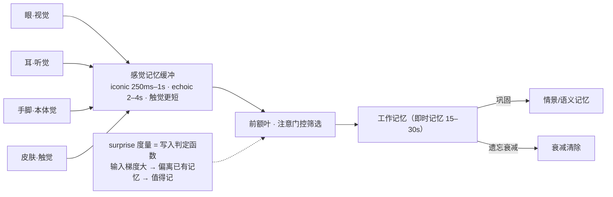

*图 2.1 感知并发 → 感觉缓冲 → 注意门控 → 即时记忆 →（巩固 / 遗忘）的链路*

### 2.5 对单体智能架构的硬约束

这一观察把备忘录的论证轴从"记忆/状态"单轴扩展为"感知并发 + 记忆内化"双轴，并对单体架构提出四项硬约束：（1）**感知入口必须是并行异步缓冲**，而非 LLM 那种"等用户说完再串行 tokenize"；（2）**必须有易失的即时记忆状态层**，带时间戳与显著性标记——MemGPT 的 working context 是静态的，而真实工作记忆是动态的、受注意门控的；（3）**必须有注意门控模块**，否则并发输入直接冲垮工作记忆（这又是一处"Agent 需要前额叶式调控层"的硬证据）；（4）**写入必须低延迟**——人脑多路并发 + 即时记忆是毫秒~秒级闭环，而纯 Transformer 外接向量库的"读回 context + 写入再检索"延迟高数个数量级且无法原生并行多通道，这把"Transformer 不改，没法实现记忆及时更新与存储"的结论又钉死一层。前述带状态、可流式更新的架构（TTT/Mamba）正是其落脚点。

## 三、发育与自我进化：从低级大脑起步

前述讨论默认"强基座 + 外壳"：先有一个已很强的模型，再外挂单体外壳。但更贴近生物真实、也更可能逼近"单体"的路径是：**基座本身也从弱到强地长出来**——一个"低级大脑"通过与环境互撞、积累经验、自我巩固，逐步发育为强智能体。这一发育观把单体智能从"造超人"拉回"养孩子"。

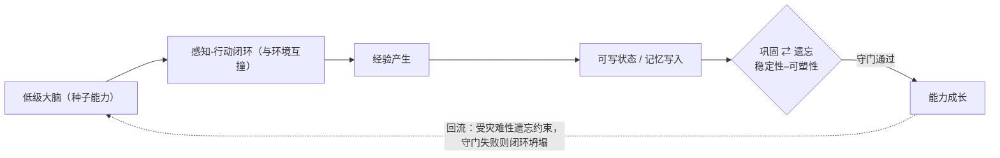

*图 3.1 自我进化闭环：从低级大脑起步，经感知-行动闭环积累经验、写入可写状态，由巩固–遗忘守门，能力回流成长*

### 3.1 从弱到强的两相对应

生物侧：突触可塑性（经验改连接）、关键期（特定能力在特定阶段猛长）、髓鞘化（处理提速）、皮亚杰认知发展阶段（感知运动 → 前运算 → 具体运算 → 形式运算）——能力是**分阶段涌现**的，非线性加载。AI 侧：发育式 AI、课程学习、持续学习提供了机制，但必须诚实区分——今天大模型的"成长"仍由**人类设计的课程**驱动（数据顺序、RLHF、分阶段微调），并非自主进化；真正"从零自主长强"仍是开放研究。

### 3.2 种子能力最小集：预装学习规则，而非知识

核心判据不是"哪些有用"，而是"哪些能力一旦缺失，系统就连第一步学习都发生不了"——即不可还原的启动依赖（bootstrapping dependency）。能从交互中习得的，不必预装；只有"学习本身得以发生"的先决条件，才必须出厂固件化。

**必须预装的 5 项机制**：

（1）**感知–行动 I/O 接口（原始、未语义化**）——没有通道就没有输入、反馈与经验，这是与环境耦合的物理前提；预装的是信号接收 + 动作执行并观察后果，而非"看得懂猫"等语义。（2）**可写状态 / 可塑性**——没有它经验写不进去，成长根本不发生；预装的是"能更新"的机制而非"写了什么"。（3）**预测误差 / 显著性驱动**——必须有信号告诉自己"什么值得记、什么算意外"，对应 RL 的 reward，也精确对应 Titans 的 `surprise`；建议硬编少量原始驱动（预测误差最小化、内感受负反馈）顶着早期，再让可学习价值近似器后天细化，以避免"自举悖论"（早期无评价器时学不了评价器）。（4）**极简注意门控**——"哪路 surprise 高就注意哪路"的最简规则即够，目标系统后天长。（5）**原始内驱力**（探索、减少不确定性、内感受平衡）——给学习一个方向感，是价值的锚而非价值本身。

**不预装的（留给后天**）：世界模型/因果（由"预测误差最小化"长期涌现）、语言/符号/抽象/自我模型/具体目标与知识（经验与社会交互产物，皮亚杰后期才出现，且语言强依赖社会文化输入）。

**核心洞见**：最小集的本质是"预装学习规则，不是预装知识"——基因预装的是发育规则与可塑性，而非具体记忆。世界模型、语言、抽象、自我、知识，全是这些规则在环境里长期跑出来的副产品。这与生物学完全一致。

| 最小预装 | 现有技术对应 |
| --- | --- |
| 感知–行动 I/O | 多模态 encoder + 效应器（VLA 模型） |
| 可写状态 | TTT / Mamba / Titans 的可写状态层 |
| 预测误差驱动 | Titans 的 surprise（input gradient） |
| 极简注意门控 | Titans 的短期注意力 + 遗忘门 |
| 原始内驱力 | intrinsic reward（好奇心 / 预测误差最大化） |

**边界**：自举悖论（价值评价器需被学习但早期无评价器）靠"硬编码原始驱动先顶着"化解；价值锚定/对齐问题——若原始内驱力只有"减少预测误差 + 探索"，系统可能长出与人类价值无关的偏好，故"低级大脑"可能还需预装价值锚（如对生命体损害约束的硬编码），纯认知讨论绕不开。

### 3.3 自我进化的命门：稳定性–可塑性困境

让"低级大脑"越变越强而非越变越乱，必须同时满足矛盾的两件：**可塑性**（能写新经验、学新东西）与**稳定性**（学新的不冲掉旧的，即克服灾难性遗忘）。二者此消彼长——纯可塑则灾难性遗忘，纯稳定则僵化学不动。它与"巩固与遗忘"是同一枚硬币的两面。

**生物的解决路径（启发源**）：① 互补学习系统（CLS, McClelland）——海马快速暂存新经验（高可塑、易覆盖），新皮层缓慢整合（低可塑、稳固），睡眠时海马**回放（replay**）把内容蒸馏进新皮层；② 突触巩固——重要突触被标记稳固、受保护，新学习优先动可塑突触；③ 稀疏编码——少数神经元响应特定输入，新建记忆只动少量连接；④ 神经发生——成年海马持续产生新神经元，提供"干净"可塑容量；⑤ 注意/门控保护——被注意标记的重要记忆获保护。

**AI 侧武器库**：参数隔离（adapter/LoRA、MoE 分专家、PackNet 掩码）；正则保护（EWC 弹性权重巩固、SI、MAS——估计参数对旧任务重要性并惩罚其变化，是"突触巩固"的精确 AI 实现）；回放/重演（存旧样本或生成式伪样本，对应生物睡眠回放，连续学习最有效手段之一）；可写状态架构天然缓解（Titans 遗忘门、SSM 固定状态、DNC 读写分离，架构层把可塑/稳定分家）；元学习（MAML，学"怎么学"）。

> **暂存层（海马类比**）：高可塑、快写、易覆盖 → 对应情景库 / Titans 神经记忆 / 工作记忆。新经验随意进，不怕写。
> **稳固层（新皮层类比**）：低可塑、慢整合、难改 → 对应固化参数 / 经巩固蒸馏的知识。保稳定。
> **离线巩固（睡眠回放类比**）：枢纽——把暂存层里"高频 + 稳定 + 重要"的内容按显著性筛选，缓慢蒸馏进稳固层。这正是"反思抽象式遗忘 + 固化门槛"的机制化。
> **关键设计**：可塑性在暂存层兑现，稳定性在稳固层兑现，两全；写入暂存自由（保可塑），仅三重验证者缓慢进稳固（保稳定），遗忘门负责暂存去噪。

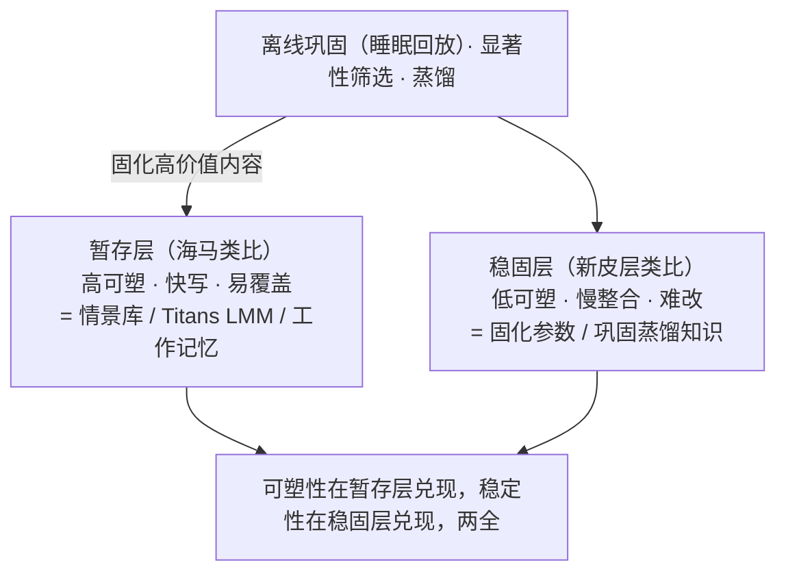

*图 3.2 互补学习系统（CLS）双系统结构：暂存层（高可塑）与稳固层（低可塑）由离线巩固枢纽连接*

**对从零发育的特殊性**：早期知识极少，几乎全是可塑性需求，稳定性负担小；随成长知识积累，稳定性负担变大，巩固机制须同步成熟。优雅的设计是**让"可塑性率"随经验量衰减**——经验少时高可塑（大胆试错），经验多时高稳定（保护核心），这恰是生物关键期的数学化。

> 诚实边界：EWC/回放/LoRA 隔离在"已知任务边界"的持续学习里可用；开放问题包括：① 无明确任务边界的连续流（真实环境无"任务结束"信号）；② 生成式回放有漂移风险；③ "什么值得固化"会判错，固化错代价极高；④ 真正的"参数层面持续学习而不遗忘"仍是开放科学问题（"魂未至"所指）；⑤ 元学习在分布漂移下退化。

### 3.4 CLS 在 TTT / Titans 上的具体落地

TTT/Titans 不是"又一个模型"，而是第一个在架构契约层面为 CLS 准备好原语的序列模型。Titans 的三层记忆架构几乎是 CLS 的天然宿主。

| Titans 三层 | CLS 角色 | 机制对应 |
| --- | --- | --- |
| 短期注意力（STM） | 工作记忆（瞬态） | 窗口内注意力，承载此刻上下文，纯瞬态不长期存 |
| 神经记忆模块 LMM | 暂存层（海马·高可塑） | 深度 MLP 作记忆，测试时梯度步更新自身权重；surprise 大→强写入；遗忘门 α_t 管容量 |
| 持久记忆 | 稳固层（新皮层·低可塑） | 训练时固化、推理时不更新的任务无关权重 |

**关键缺口**：原生 Titans 的 LMM 是单一神经记忆，同时承担"快速写"与"长期存"，未把"暂存→稳固"的离线蒸馏显式拆出。落地核心动作是**在 LMM 之外再引一个"慢记忆"并接离线蒸馏步骤**，三种补法：方案 A｜双层 Titans（快 LMM + 慢 LMM），慢记忆低频批量更新（"睡眠窗口"用快记忆里高访问×surprise 累积×时间衰减内容做一步梯度更新，仍是非参数状态，避灾难性遗忘）；方案 B｜TTT 内部模型 + 参数固化，周期性把收敛稳定、高频复用子结构经 LoRA 蒸馏固化进适配器；方案 C｜surprise 驱动累积显著性 + 固化阈值，给每条记忆加累积权重 `s_t = f(访问频率, surprise 累积, 时间衰减)`，超阈值触发固化、低于阈值且久未用则遗忘门清空，改动最小。

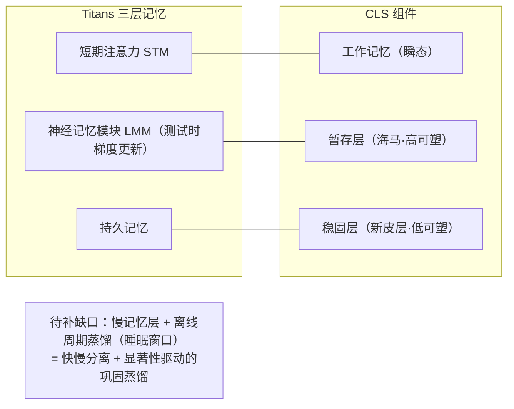

*图 3.3 CLS 与 Titans 三层记忆的映射，及需补的"快慢分离 + 离线巩固"缺口*

**固化到哪的决策**：固化进"慢神经记忆"（方案 A/C）仍是外部状态、更新频率低、不动主干 → 不触发灾难性遗忘，实现简单，首选；固化进"主干参数 / LoRA"（方案 B）真正"长进脑子"但风险高（固化错代价大、覆盖旧知识），须用 EWC 类正则或 LoRA 隔离保护——这正是 CLS 里"新皮层"角色，AI 侧要格外小心。

**完整对照**：

| CLS 组件 | 生物 | TTT / Titans 落地 |
| --- | --- | --- |
| 工作记忆（瞬态） | 前额叶 | 短期注意力（STM） |
| 暂存层（高可塑） | 海马 | LMM / TTT 内部模型（测试时梯度更新） |
| 稳固层（低可塑） | 新皮层 | 持久记忆 + 慢记忆 / LoRA |
| 离线巩固蒸馏 | 睡眠回放 | 周期批量更新（"睡眠窗口"） |
| 显著性筛选 | 注意/门控 | surprise 度量 + 累积显著性阈值 |
| 遗忘去噪 | 遗忘 | 数据依赖遗忘门 α_t |

> 诚实边界：Titans 原生只有单层神经记忆，显式快慢分离 + 离线蒸馏是工程增量而非现成；固化进参数的灾难性遗忘风险仍在，EWC/LoRA 仅兜底未根除；"睡眠窗口"在实时 agent 的排布（后台异步 / 定时 / 空闲触发）是系统工程问题；慢记忆与快记忆的冲突裁决需元数据支撑；TTT/Titans 多在语言建模基准验证，未在"持续发育 agent"场景实证。

### 3.5 快慢记忆的冲突裁决设计

冲突 = 同一 `key`（实体/规律）在快记忆（新、易变）与慢记忆（旧、稳固）里表达不一致。裁决须回答三问：① **检测**（如何发现）；② **谁胜**（按什么信号）；③ **写回**（结果如何落两层）。核心原则：默认保守（保稳定），强证据才反转，能分域则分域，拿不准则软标记或升级人工。

**裁决信号（多维融合，非单信号**）：时间新鲜度、来源可信度（用户输入 > 推理猜测；权威库 > 闲扯）、证据强度/一致性（被多少独立记忆支撑）、固化层级（entrenchment，慢记忆已三重验证，推翻门槛高——对应 EWC 重要性权重）、surprise 累积（偶发多是噪声，持续高 surprise 才是真新规律）、作用域（scope，冬北京/夏上海非冲突而是带语境多值）。

**五种裁决策略**：（1）**加 scope 并存**：作用域可消解时给两条记忆加语境标签并存、检索时按语境路由，避免覆盖导致信息丢失；（2）**再巩固（reconsolidation**）：当新记忆在"可信度×证据强度×新鲜度×持续 surprise"上超反转阈值 → 更新慢记忆、旧值降级或归档，对应生物"提取旧记忆时重开可塑窗口被改写"；（3）**软标记观察**：score 低但非零 → 不立即裁决、降权加疑义标记、观察后续证据，降低误裁决代价（呼应"固化错代价高"）；（4）**升级人工（escalation**）：高重要性 + 证据对等 + 涉及身份/安全/价值锚 → 不自动裁决、标记 pending 留用户/系统确认（对应被遗忘权与价值锚定）；（5）**慢记忆保持·新仅留快**：score≈0（弱且孤立的新记忆撞稳固旧知）→ 默认保守，旧不动，新只在快记忆待着，等其遗忘或积累证据。

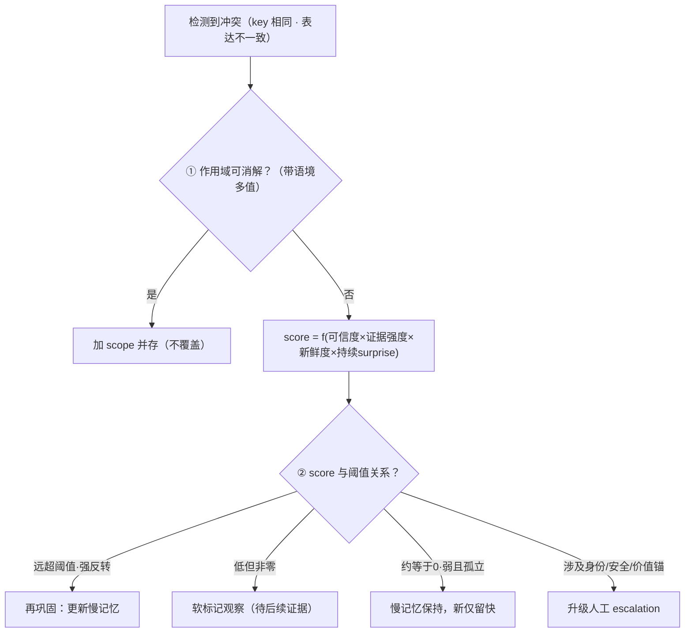

*图 3.4 快慢记忆冲突裁决决策树（默认保守，强证据才反转）*

**元数据基础设施**：所有记忆须带结构化元数据，否则无法裁决——`key/entity_id、timestamp、source+reliability、evidence_count、surprise_accum、entrenchment/consolidation_level、scope/context_tags、confidence/uncertainty、status(active/deprecated/pending/disputed)`。

**裁决何时发生**：落在"睡眠窗口"。在线时 LMM 即时写入（快记忆内部冲突由遗忘门 + surprise 处理）；离线蒸馏时，快记忆高价值内容与慢记忆比对，方触发上述裁决树——这正是生物睡眠期记忆重组（整合 + 去冲突）的数学化。

**生物对应**：再巩固（提取即重开可塑窗口 → 我们的 reversal）、存活依赖提取（不用的记忆弱化 → 时间衰减 + 证据强度）、图式同化（冲突时同化或改写图式 → 证据强度裁决）、元记忆（知道自己记的可靠度 → 每条记忆带 confidence/uncertainty）。

> 诚实边界：信号权重初版必粗糙、需数据标定；早期 agent 经验少、"证据强度"近乎空，裁决天然弱（与关键期高可塑低稳定一致）；恶意/错误输入可反复制造高 surprise 骗过反转阈值，需 source reliability + escalation 兜底（又回到价值锚定/对齐）；作用域消解依赖好的上下文表示。

### 3.6 冲突裁决的工程原型

把 3.5 的决策树落成可跑的工程，需要四件套——记忆记录的数据模型（Schema）、冲突检测、裁决打分函数、写回路由——再被"睡眠窗口"串联为离线管线（图 3.5）。下面给出一套可直接实现的原型。

#### 3.6.1 记忆记录的数据模型

每条记忆（无论快慢）须带结构化元数据——这是裁决的前提，否则多维信号无从融合。快记忆的可写状态层（Titans LMM 或 TTT 内部模型）天然携带 `key/value/timestamp/surprise`，慢记忆（持久记忆或慢 LMM）额外带 `entrenchment`；两者共享同一 Schema，索引以 `key` 为主键 + 嵌入索引做模糊键匹配（捕获"过敏"与"青霉素过敏"的键关联）。

| 字段 | 类型 | 语义 |
| --- | --- | --- |
| mid | string | 唯一 ID |
| key | string | 归一化实体.关系键，如 "user.allergy" |
| value | any | 记忆内容 |
| scope | {context, loc, temporal} | 作用域标签，用于消解"伪冲突" |
| timestamp | datetime | 写入 / 固化时间 |
| source | enum | user_input \| sensor \| inference \| external_kb |
| reliability | float[0,1] | 来源可信度 |
| evidence_count | int | 独立佐证条数 |
| surprise_accum | float[0,1] | 累积偏离度（持续高 = 真新规律） |
| entrenchment | float[0,1] | 固化深度（EWC 重要性权重），仅慢记忆显著 |
| consolidation | int | 0 易逝 / 1 候选 / 2 固化 |
| confidence | float[0,1] | 自身可靠度 |
| importance | float[0,1] | 是否涉及身份 / 安全 / 价值锚 |
| status | enum | active \| deprecated \| pending \| disputed |

#### 3.6.2 冲突检测

`scope_disjoint`：结构化比较 context/loc/temporal 是否无交（"冬天北京" vs "夏天上海" → 不冲突，按语境路由）。`values_consistent`：可插拔一致性检查器——结构化否定检测、嵌入距离、或 LLM-as-judge；原型用嵌入距离阈值 + 结构化相等性兜底。注意：冲突只在"快 vs 慢"之间裁决；快-快分歧用同函数先内部收敛、胜者再晋级；慢-慢不应存在（已固化一致性）。

#### 3.6.3 裁决打分函数（多维信号融合）

核心是"慢记忆有防御、新记忆需越过反转门槛"——不是简单的新覆盖旧：

`entrenchment` 抬门槛但不致瘫——当 `reversal_strength` 压倒性高（如用户亲述 + 高可信 + 多佐证）仍能越过防御；权重 `ENT_W` 及各分量权重需用真实数据标定，初版必粗糙。

#### 3.6.4 裁决决策状态机（五种策略）

设计原则：**默认保守（保稳定），强证据才反转，能分域就分域，拿不准就软标记或升级人工**。前三条对应生物"再巩固 / 图式同化 / 元记忆"，第四条对应价值锚定。

#### 3.6.5 写回路由

| 策略 | 写回动作 |
| --- | --- |
| COEXIST | 两记忆保留，加 scope 标签；检索按活跃语境路由 |
| RECONSOLIDATE | 慢记忆值/时间/证据更新，旧值 deprecated；快记忆 consolidation → 2 |
| SOFT_MARK | 双方 disputed + 降权 + watch++；不写慢，等后续证据 |
| ESCALATE | 双方 pending；生成人工复核任务；自动写阻断 |
| KEEP_SLOW | 慢不变；快留 fast（consolidation=0），由遗忘门最终衰减 |

#### 3.6.6 睡眠窗口编排（裁决的发生地）

在线时 LMM 即写即更（快记忆内部冲突由遗忘门 + surprise 处理）；**离线"睡眠窗口"才触发显著性累积、冲突检测与裁决**——这正是生物睡眠期记忆重组（整合 + 去冲突）的数学化，且绝不阻塞在线推理。

"睡眠窗口"在实时 Agent 中的排布是系统工程问题：空闲触发 / 定时（如每日凌晨）/ 后台异步队列均可，关键是让裁决在在线推理之外完成。

#### 3.6.7 工作示例：过敏史冲突

**慢记忆**：`user.allergy = "无已知过敏史"`，entrenchment 0.9，evidence 12，source external_kb，scope `*`。**快记忆**：`user.allergy = "青霉素过敏"`，scope 医疗，timestamp 现在，source user_input，reliability 0.95，evidence 3，surprise_accum 0.8。

流程：作用域重叠（医疗 ⊂ `*`）→ 真冲突；涉及健康 → `involves_safety = True` → 即便反转分中等，**安全旗触发 ESCALATE** → 双方 pending，建人工复核；用户确认后 **RECONSOLIDATE**：慢记忆值更新为"青霉素过敏"、scope=医疗、timestamp=now、evidence 合并。

这正是安全行为：**不因一次强证据就静默改写医疗史，而是升级确认**——价值锚原则在冲突裁决里的具体落地。

#### 3.6.8 工程边界

> 信号权重初版必粗糙，需数据标定；早期 agent 经验少，evidence_count 近空，裁决天然弱（与关键期高可塑低稳定一致）。恶意/错误输入可反复制造高 surprise 骗过反转门槛 → 需 reliability + ESCALATE 兜底（回价值锚定）。作用域消解依赖好的上下文表示，否则误判/漏判。冲突检测的计算成本：需为 key 建索引 + 嵌入检索；大规模时增量更新而非全量扫描。

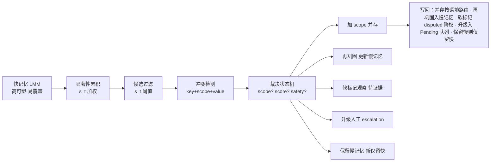

*图 3.5 冲突裁决工程管线：快记忆 → 显著性累积 → 候选过滤 → 冲突检测 → 裁决状态机 → 五种写回路由*

## 四、类人单体智能的设想与可行性边界

设想一个"像一个人"的单体智能：记忆从脑内获取，而非每次思考都外接代入上下文；非为多路并发服务，而是有连续自我、能持续积累经验的持续体。该设想与当前"无状态 LLM + 外接管线"范式有本质分野。

### 4.1 范式对比

| 维度 | 多体管线（当前） | 单体智能（目标） |
| --- | --- | --- |
| 状态 | 无状态，每次调用重生 | 有状态、持续存在 |
| 记忆位置 | 外部向量库/数据库 | 脑内（内化 + 可写） |
| 上下文来源 | 外部拼装 | 内外实时耦合 + 主动门控 |
| 自我边界 | 无自体模型 | 有自体模型与元认知 |
| 学习 | 训练-推理分离 | 持续学习、可巩固、可遗忘 |

### 4.2 可行性结论

方向完全正确，且是"工具型 LLM"走向"类人智能体"的必经之路。但"完全类人"当前科学与工程都做不到。可工程化大部分（状态持续性、内化记忆、内部检索、内部模拟）；而**持续学习/巩固（不遗忘**）仍是核心科学障碍。关键要判断"能内化什么"与"必须由外界喂什么"：个体经验、人格设定、长期偏好、领域沉淀可内化；而**当下刺激本身（用户输入、传感器、当前任务指令）永远必然外接**——没有任何智能能凭空想出此刻外界发生了什么。因此目标应是"只外接当下刺激，其余记忆从脑内取"，与人脑一致。

### 4.3 必要非充分条件

记忆内化是必要条件而非充分条件。真正让一个智能"像一个人"，还需齐备：持续状态、内化且会遗忘的记忆、世界模型（内部因果/动态模拟，替代纯外接感知）、自体模型与元认知（区分"我"与"环境"、校准不确定性）、具身行动闭环（第一人称经验积累）、以及持续学习。其中"巩固与遗忘"与"持续学习"是现在最空白的一环。

## 五、工程案例：原型已经存在

以下系统已在"状态 / 内化记忆 / 内部检索"上命中不同能力块，但均距"真正单体"有缺口：

| 案例 | 命中能力 | 做法 | 离真正单体差什么 |
| --- | --- | --- | --- |
| MemGPT / Letta（Berkeley, 2023） | 内化记忆 + 内部检索 | 上下文类比为有限内存，分工作/召回/归档三级，Agent 自主调用工具读写、递归摘要 | 记忆仍外置，不进参数；无真正遗忘 |
| Generative Agents（Stanford, 2023） | 内化记忆 + 巩固 + 加权检索 | 观察流按近期性/重要性/相关性打分；周期性反思升华高层信念 | 无参数固化；反思算力昂贵；不持续 |
| ChatGPT Memory / Claude Projects | 状态持续 + 内化记忆 | 跨会话记住用户事实与偏好 | 由系统/用户管理，Agent 不自主巩固；无遗忘机制 |
| Zep / Mem0（开源） | 内化记忆 + 遗忘触发 | 知识图谱 + 时间/注意力衰减；去重、冲突消解 | 外部中间件，未与参数闭环；固化缺失 |
| Voyager（NVIDIA, 2023） | 能力内化（技能固化） | 自动把解法固化为可复用技能库并迭代 | 固化的是程序/技能，非通用记忆 |

**小结**：状态持续性已经成熟（LangGraph/AutoGen 的 checkpoint 亦属此类）；内化记忆与内部检索有可用原型（MemGPT、Zep）；但"进参数"与"遗忘"两块，目前全为空缺或半成品。即"壳能造、魂未至"。

## 六、记忆的巩固与遗忘机制

真正把"单体"与"高级工具"分开的，恰恰是最空白的两块：把经验可靠地固化进参数，以及让记忆像生物一样会巩固、会遗忘。

### 6.1 哪些该固化进参数（固化层）

**判据**：高频、稳定、跨情境通用、与身份/人格/领域核心强相关、长期不易变。**典型内容**：用户稳定身份与长期偏好；Agent 核心人格/角色设定；领域本体与公认硬知识；反复验证有效的策略、套路、技能；经反思提炼后稳定的高层信念。**固化方式**：周期性微调（全量或 LoRA）、把经验蒸馏进更小专用模型、或把高频有效技能直接编码。**门槛必须高**：只有经"高频 + 稳定 + 重要"三重验证的经验才配进参数，偶发、可能过时、存疑的一律留情景库——因为固化是难改的，固化错了成本极高。

### 6.2 哪些该留在情景库（情节记忆）

**判据**：具体、偶发、上下文强相关、可能过时、需可追溯、需携带原始细节。**典型内容**：单次具体对话、某项目具体决策与理由、交互情绪基调、临时上下文、待办与未竟事务。**特点**：可读写、可检索、可修正、可删除，是"工作记忆的外延"，容错（错了能改、旧了能忘）。一句话：情景库是草稿纸，参数固化层是定稿教科书；草稿可乱可丢，定稿必须慎。

### 6.3 遗忘如何触发

遗忘不是 bug，是归纳去噪的必要机制——没有它，记忆会熵增到不可用。五类触发：

**时间衰减**：越久未访问权重越低（如 Zep）。缺陷是会误伤"长期重要却偶用"的事（如过敏史），故必须与重要性耦合而非纯靠时间。**容量淘汰（LRU**）：库触顶时淘汰最不重要/最久未用者，是工程兜底，须配合重要性打分。**冲突覆盖**：新经验与旧记忆矛盾时，按时效性 + 可信度 + 来源优先级覆盖旧的（严格说是知识更新，非遗忘）；前提是每条记忆带元数据。**显式擦除**：用户/合规要求"忘记 X"、隐私删除、被遗忘权，必须可靠且可审计。**反思抽象后丢弃细节**：最具智能感——把琐碎观察提炼成高层信念后，原始细节可丢，模拟生物睡眠巩固（遗忘噪声细节、保留意义），使记忆越用越凝练而非越用越臃肿。

### 6.4 软遗忘与硬遗忘

设计上区分两层：**软遗忘**（降权、降低检索优先级，仍可恢复）与**硬遗忘**（彻底删除，用于合规/冲突）。记住：固化的参数层最难遗忘——固化错了只能靠再训练或"反固化"补救，这是为何 6.1 强调固化门槛必须高。

## 七、Transformer 架构的适配性评估

核心判断：Transformer 能满足"下一代单体智能的推理引擎"需求，但满足不了"单体智能的整体架构"需求。它缺的不是"不够大"，而是架构契约本身。

### 7.1 它胜任的部分

推理/语言/泛化的核心仍是最强可用基座；注意力本身就是"软检索"（query-key-value 与记忆检索同构，是 RAG 能成立的根）；超大 context 能临时承载长期记忆。但后两者只是临时方案。

### 7.2 结构性缺失（灵魂缺失的架构根源）

| 缺失项 | 说明 | 对应单体需求冲突 |
| --- | --- | --- |
| 无状态 | 每次前向只看见当前窗口，无跨调用内部状态 | 持续存在不成立 |
| O(n²) | 长记忆直接入窗计算和显存二次爆炸 | 脑内取用不可持续 |
| 参数只读 | 推理时权重不可写，新经验无法长进脑子 | 在线持续学习不成立 |
| 缺显式世界模型/因果 | 相关性机器，非因果/动态模型机 | 内部模拟（DMN）缺位 |
| 扁平上下文 | 系统提示/固化知识/刚说的话被拍平成 token | 无分层记忆结构 |

### 7.3 演进路径（非此即彼，逐层包裹）

**短期**：Transformer 主干不变，外套管"单体外壳"——持久状态层、分层记忆、巩固/遗忘机制、可选 world model（即"Transformer 当引擎，外壳补魂"）。**中期**：混合架构，让 Transformer 负责联想/语言/模式，让 SSM（Mamba、RWKV）负责长程状态与流式记忆（线性复杂度、天然带状态）。**长期/前沿**：可能超越 attention 的范式——预测编码网络、可微神经计算机（DNC）、神经形态/类脑架构，均为开放研究。

### 7.4 押注建议

不赌 Transformer 被立刻取代（短期不可能），但要把"记忆/状态/巩固/世界模型"做成与主干**解耦**的子系统——外壳设计成"主干无关"：今天主干是 Transformer，明天切到 SSM 或混合架构，单体智能的上层（身份、记忆、巩固逻辑）不受影响。真正该现在投入设计的，是那套"主干无关的单体外壳"，尤其是最空白、也最决定"单体"是否成立的巩固与遗忘机制。

## 八、可写状态的实质性突破（2025–2026）

2025–2026 年，"非纯 Transformer、带可写状态"方向出现实质性推进，且分布不均：

### 8.1 SSM / Mamba / RWKV —— 工程产品化

混合架构已成主流落地形态（AI21 Jamba、NVIDIA Nemotron-H、IBM Granite 4.0、腾讯 Hunyuan-TurboS、微软 Phi-4-mini-flash 等），长上下文内存与吞吐显著优于纯 Transformer。纯 SSM 有结构性弱点（固定大小状态压缩有损，精确复制/关联回忆系统性失败，故落地均保留少量 attention 补精确回忆，反向印证"无状态/压缩有损"问题）。RWKV-7 "Goose"（2025.03）引入动态状态演化 + 广义 Delta Rule，理论上超越 Transformer 的 TC0 限制。**评估：工程突破已确认，但本质是更高效的序列处理，离"脑内记忆"还差一层语义**。

### 8.2 记忆网络 / DNC → Titans —— 实质性复兴

经典 DNC（Graves 2016）之后思路被注意力与 RAG 吸收，十几年未进主流。2025 年的信号是 Google 的 Titans + MIRAS（2025.01）：把"长期记忆"做成深度 MLP 记忆模块，在推理时（test-time）用梯度步更新自身权重，用"surprise 指标"（预测误差大=重要=强写入）决定记什么，用"遗忘门"（自适应权重衰减）管理容量，BABILong 上超过 GPT-4，2M+ token 检索不衰减。这是 DNC 思想在 Transformer 时代的现代复活，最贴近"脑内可写记忆"语义。

### 8.3 可塑权重 / 神经形态 —— 研究活跃，未规模突破

持续学习/灾难性遗忘仍是开放问题，但有希望方向：QF（Quick Feedforward，2025.07）免反向传播闭式写入 Transformer 权重、保留旧知识；TMCL（NeurIPS 2025）脑启发对比巩固；神经形态/SNN + STDP 仍研究阶段。神经形态硬件有进展，离大规模实用远。

### 8.4 三者汇流于 Test-Time Training

最关键发现：三条线在 2025 被同一框架统一——TTT。数学上，Mamba/DeltaNet/xLSTM 的循环动力学都可从"in-context 回归目标 + 在线学习规则"导出；Titans 即"记忆模块在测试时梯度更新"，MesaNet 即"每步用共轭梯度在线优化状态"。即 SSM 的可写状态、DNC 的可写记忆矩阵、可塑权重的在线更新，在 2025 被统一理解为"模型在运行时通过某种梯度/Hebbian 规则更新内部状态或权重"。

## 九、Test-Time Training（TTT）汇流：统一框架详解

TTT 是这几条线里信息量最大的一条——它不只是又一个架构，而是把 SSM、记忆网络、可塑权重在数学上统一了起来。

### 9.1 核心机制

核心论文 Sun et al.（ICML 2025, arXiv 2407.04620）的关键洞察：所有循环层 = 隐藏状态 + 更新规则。传统 RNN/SSM 的隐藏状态是固定大小向量，被迫压缩历史（有损、易饱和）；Transformer 把历史全塞进 KV cache 但 O(n²)。TTT 取"第三路径"：

> **隐藏状态 = 一个小的机器学习模型（其权重 W**），可以是线性模型（TTT-Linear）或两层 MLP（TTT-MLP）；
> **更新规则 = 对内部模型做一次自监督梯度步**：`W_t = W_{t-1} − η·∇ℓ(W_{t-1}; x_t)`，训练目标重建当前输入（无需标签）；
> **输出 = 用更新后的权重产生**：`z_t = f(x_t ; W_t)`。

它用**双层优化**实现：外循环（训练时）优化大模型本身 + 自监督任务的视图投影；内循环（推理时）对每个 token 更新内部模型权重。关键结果：32k 的 Books3 长上下文上，Mamba 在 16k 后 perplexity 平台化，而 TTT 与 Transformer 一样持续下降——"把上下文存进一个会学习的内部模型"比"压缩进固定状态"表达力高一个量级。

### 9.2 精确统一关系

TTT-Linear 在 `W_0=0, lr=1/2` 时精确坍缩为线性注意力，故它是对线性注意力、DeltaNet 的严格推广而非类比。2024 年 "Transformers are SSMs"（被引 127）证明 Mamba/DeltaNet/xLSTM 循环动力学全可自 in-context 回归目标 + 在线学习规则导出。

### 9.3 三条主要实例化路径

| 路径 | 出处 / 规模 | 核心做法 | 推进点 | 关键结果 |
| --- | --- | --- | --- | --- |
| TTT 层（原始） | Sun et al., ICML 2025；125M–1.3B | 隐藏状态=Linear/MLP，内循环一步梯度 | 基线 | 32k 超 Mamba；TTT-MLP 有 memory I/O 瓶颈 |
| MesaNet | von Oswald et al.（Google），ICLR 2026；billion 级 | 用快速共轭梯度求解器，每时间点把 in-context loss 最小化到最优；分块并行 | 从"近似"升级到"Locally Optimal"，可并行、可上规模 | perplexity/下游优于前代 RNN；代价是推理更多 FLOPs |
| Titans | Behrouz et al.（Google），NeurIPS 2025；已验证 | 三层记忆（短期注意力+长期神经记忆模块 LMM+持久权重）；Surprise 度量驱动写入；自适应遗忘门 | 补上"写什么、忘什么"细化机制，最贴近生物巩固 | BABILong 超 GPT-4，2M+ token 不衰减 |

**Titans 的细节**：用输入梯度 `∇ℓ` 当 Surprise 度量（梯度越大越值得记）；动量式更新 `S_t = η_t·S_{t-1} − θ_t·∇ℓ`（融合 momentary + past surprise）；遗忘用数据依赖的遗忘门 `α_t`（→0 保留、→1 清空）。它被证明是 Gated DeltaNet 的严格推广，DeltaNet、Longhorn、RWKV-7、TTT 全是特例。后续 MIRAS 框架（2025.12 Google blog）又生成 YAAD / MONETA / MEMORA 三个变体。

### 9.4 补充：TTT-E2E 与 TTT-Video

**TTT-E2E**：元学习一个"适合被 TTT 更新的初始权重"，滑动窗口 Transformer 只更新最后 1/4 层，加 static storage MLP 防遗忘；在 3B / 164B tokens 上，128k 上下文 loss 几乎贴全注意力曲线，推理延迟恒定，比全注意力快 2.7 倍。**TTT-Video**（CVPR 2025）：TTT-MLP 加入 CogVideoX-5B（50 亿参数），生成一分钟连贯 Tom & Jerry 视频，比 Mamba-2 / Gated DeltaNet 领先 34 Elo 点。

### 9.5 与原始问题的呼应

这恰好回答"Transformer 不改，没法实现记忆的及时更新和存储"：TTT / Titans / MesaNet 的共同本质就是"模型在运行时通过梯度/Hebbian 规则更新自己的内部状态或权重"——这是"可写状态 / 脑内记忆"的第一个可工程化原型，且不再依赖外挂向量库。Titans 的 surprise 写入 + 遗忘门，几乎精确复刻了生物的"巩固—遗忘"机制。

### 9.6 诚实边界

> 必须划清的边界：① 它仍是"运行时状态更新"，不是"固化进参数"——和"长在脑子里、无需外接"还有一层距离，介于外挂与真正内化之间；② 推理时多花 FLOPs（用 test-time compute 换记忆）；③ 规模与产品化未定（前沿超大模型主干仍以纯 Transformer 为主，Titans 截至 2026 仍研究架构、无公开产品集成）；④ 遗忘门是学出来的启发式，非生物级真正巩固，灾难性遗忘在参数层面仍未被根除。

## 十、算力载体与硬件契约：CPU、GPU、ASIC 与 FPGA×TTT

前四根支柱（记忆内化、感知并发、可写状态、发育进化）讨论的都是架构与机理，但最终都必须落到物理载体上。本章补上第五条轴：单体智能究竟运行在什么硅片上。核心判断是——**这不是"CPU 还是 GPU"的二选一，而是按负载分层的异构底座；并且单体最核心的"边跑边写权重"那一层，今天 CPU 与 GPU 均不适配，会逼出一条新的硬件契约**。

### 10.1 负载分层：状态与记忆不是 GPU 的主场

单体智能的负载可切为四类，计算形态截然不同：多路感知与注意门控是事件驱动的稀疏异步流；持续状态、记忆读写、巩固遗忘、冲突裁决是内存密集、控制流密集、随机访问的负载，本质是"数据库 + 状态机"而非算力；联想前向才是稠密矩阵乘；离线巩固（睡眠窗口的蒸馏、索引重建、冲突裁决）则可批处理、吞吐优先。**最像"智能"的那几部分，恰恰不在 GPU 的主场**。

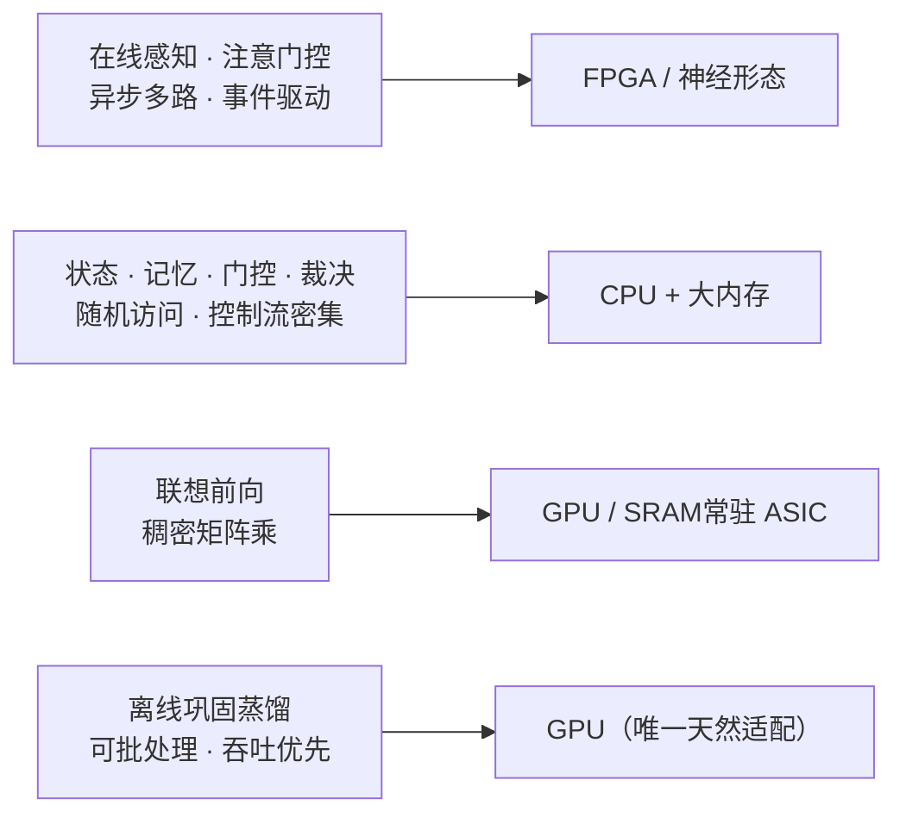

*图 10.1 单体智能的计算负载分层与硬件匹配：在线与离线在架构上天然自洽，无需妥协*

因此合理的分工是：**CPU（或类 CPU 的近存、大内存）为"主体"，专用加速器只负责"联想那一瞬"，离线周期任务批给 GPU**。这条分工把"主干无关"原则从模型架构延伸到了硬件抽象层。

### 10.2 GPU 与单体智能的结构性错配

| 错配维度 | GPU 的假设 | 单体的要求 |
| --- | --- | --- |
| batch=1 | 靠大批量掩盖访存延迟，是吞吐机器 | 一个持续个体、凑不成批；凑批与毫秒级低延迟直接冲突，算力大量闲置 |
| 权重可写 | 权重只读、算子规整、大 kernel | TTT / Titans 每 token 一步梯度改写记忆权重，产生大量小 kernel 与 HBM 往返 |
| 永远在线 | 权重与状态常驻显存、数百瓦、按小时计费 | 一个"一直活着"的个体是功耗与成本约束问题（人脑约 20W） |
| 异步多路 I/O | 整齐的张量批 | 感知并发是事件驱动的稀疏流 |

实测佐证：单张 H100、1.3B 规模、batch=1 条件下，Titans 解码为 `56.1 ms/token`，而 Transformer++ 仅 `14.8 ms/token`（约慢 3.8 倍）；340M 规模吞吐不足 2 kTPS，1.3B 训练直接 OOM。这里的关键不在算力不足，而在**为只读权重、大批量、确定性执行优化的硬件，被迫运行一个每步都要改权重的负载**。

### 10.3 三条现实硬件路线（2025–2026 实证）

| 路线 | 承载层 | 代表与实测 |
| --- | --- | --- |
| CPU / 端侧 | 状态层、编排、记忆库、工具 | RWKV 类固定状态、O(1) 内存、线性时间的架构明确可在 CPU 上运行（GGUF / llama.cpp）；今天 Agent 的编排与记忆本来就全在 CPU 侧，未来只是从"外挂管线"内化为单体的一部分 |
| 低延迟推理 ASIC | 联想层 | Groq LPU：230MB 片上 SRAM（约 80TB/s）、确定性执行、不凑批，单流 300–840 tok/s、每 token 1–3 焦耳；IBM NorthPole（2025.11）：权重与 KV cache 常驻片上、卡间只传小中间张量，288 卡仅 30kW，Granite-3.3-8B 达 2.8ms inter-token、3B 实例 1ms，官方点名面向 agentic workflows |
| 神经形态 / 存内 | 感知 + 可塑 | Loihi 2 关键词检测低于 1mW、事件驱动、支持片上学习、以时间为原生维度；Akida 峰值约 30mW。稠密矩阵乘仍以 GPU / TPU 为优，故是补充而非替代 |

三条路线的共同点正是"权重常驻 + 单流低延迟 + 延迟确定"；差别在于它们各自的定位是联想而非状态。

### 10.4 最尖锐的张力：跑得最快的推理芯片不能训练

Groq LPU 明确只做推理、不支持训练；而单体最核心的能力恰是 test-time 学习（每个 token 改权重）。这解释了 TTT / Titans 在现有硬件上为何如此慢：硬件契约与算法契约正好相反。由此可推出本章的中心命题——**单体智能会逼出一种新硬件契约：权重可写、状态常驻、单流低延迟、存算靠近。目前没有任何现成芯片同时满足这四条**。

> **唯一的天然适配点**
> 图 10.1 中"离线巩固"一行值得单独强调：睡眠窗口里的巩固蒸馏、冲突裁决与索引重建，是全系统唯一天然适配 GPU 的一环——可批处理、可离线、吞吐优先，正好回到训练范式。在线要低延迟单流、离线要大吞吐，软硬件分工在架构上天然自洽，无需妥协。

### 10.5 FPGA：可写状态协处理器与发育期载体

FPGA 恰好命中上一节的红色缺口，但它填的不是"算力"，而是"**硬件契约尚未定型**"这件事。TTT / Mamba / Titans 的更新规则仍在演进（surprise 度量、遗忘门、快慢分离均未收敛），此时把数据通路固化成 ASIC 属于过早优化；FPGA 的独特价值是契约本身可重定义。这与前文三条论证同构：与"主干无关"同构（模型主干未定，硬件也不该定死）；与"从低级大脑发育"同构（可重构逻辑约等于幼年高可塑皮层，ASIC 约等于成熟固化回路）；与"稳定性–可塑性"同构（FPGA 是硬件层的高可塑暂存层，ASIC 是低可塑稳固层）。

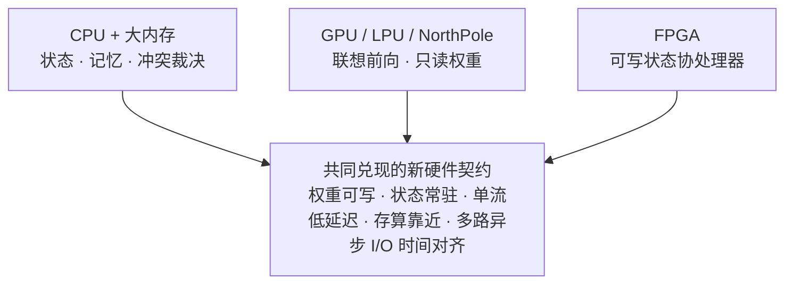

*图 10.2 FPGA 在单体智能硬件分层中的位置：补上"每步可写"这一格缺口*

### 10.5.1 2025–2026 年可直接对位的实证

| 工作 | 关键机制 | 实测 |
| --- | --- | --- |
| FlightLLM（Alveo U280 / Versal VHK158） | always-on-chip decode（解码权重常驻片上）、可配置稀疏 DSP 链 | batch=1 下比 V100S 能效高 6 倍、成本效率高 1.8 倍；VHK158 吞吐超 A100 1.2 倍 |
| EdgeLLM（CPU-FPGA, VCU128） | 混合精度 + 端到端编译器 | 7B 达 92.5 tok/s、56.8W、1.51 token/J；A100 仅 0.20 token/J、220W，且 batch=1 时 GPU 效率低于 30%，FPGA 带宽利用率 66–75% |
| SSMA（ISCAS 2025, ZCU102） | tile-stationary recurrent dataflow，在片上循环更新 latent state 与 SSM 参数 | 比优化后的 GPU 快 3.33 倍、能效高 41.8 倍 |
| LightMamba / FastMamba（2025） | 计算重排、细粒度 tiling、PoT 量化与旋转消异常值 | 利用率 58% 提升至 96%、URAM 由 246 降至 61；VCK190 能效比 RTX 4090 高 4.65 倍；prefill 比 Xeon 快 68.8 倍 |
| 片上在线学习（DPR / Auto-SNL / DTM / NeuroCoreX） | 部分重配置、AXI-Lite 运行时改权重、STDP 片上学习、事件 FIFO | 同一份 bitstream 同时跑推理与训练；DTM 系统功耗 4.36W |

其中 SSMA 的"tile-stationary recurrent dataflow、片上循环更新状态"，几乎就是 Mamba / TTT 可写状态层的硬件直译。算法侧与硬件侧在 2025 年从两个方向撞到同一点：**把"更新"做成一等公民**——Titans 用 surprise 判定写入、遗忘门管容量、选择性只更新偏离预期的部分；FPGA 侧的动态可重构工作不做完整反传，只算局部梯度并按重要性阈值生成掩膜、只更新一小撮权重。一个是软件里的门控，一个是电路里的掩膜，结构几乎同构。

### 10.5.2 三层"可重构"须划清，不可过度承诺

（1）**运行时改权重**：写 BRAM 内容或 AXI-Lite 寄存器，已成熟，对应"记忆写入"；（2）**部分重配置换数据通路或学习规则**（DPR）：可行，对应"巩固 / 发育期换规则"，但切换有毫秒至秒级开销；（3）**端到端反传改全部参数**：FPGA 能做，但尚未在 TTT / Titans 这种规模上验证。故 FPGA 解决的是"可写状态"，不是"参数级持续学习"。

> FPGA 的诚实边界：频率仅 140–280MHz 级、片上 BRAM/URAM 几十 MB，跑不了 70B 以上稠密模型，纯 GEMM 打不过 H100 / B200；绝对吞吐亦落后（LightMamba 7.21 tok/s、EdgeLLM 92.5 tok/s，对比 Groq 约 549 tok/s、NorthPole 约 357 tok/s）；开发需 HDL / HLS、综合与布局布线以小时计、换模型常需重设计重编译，生态远弱于 CUDA；常驻功耗并不极低（EdgeLLM 待机即 40.36W，优于 GPU 的 220W，但距神经形态 mW 级与人脑 20W 仍远）；SSMA、LightMamba、NeuroCoreX 均为研究原型，后者仅 100 神经元 / 1 万突触。

### 10.6 FPGA × TTT：内循环的数据通路映射

把"结合"落到数据通路层，有一块决定性基石：arXiv 2603.05931（2026.03，USC）做了**首个 Gated DeltaNet 解码的 FPGA 加速器**，而 GDN 正是 TTT 家族的特例。它把完整 2MB 循环状态常驻片上 BRAM，在 Alveo U55C 上做到 `63 μs/token`、比 H100 快 **4.5 倍**、能效高 **60 倍**、片上功耗 9.96W。

其论证可直接搬到 TTT：batch=1 解码时，GDN / TTT 类模型的算术强度仅约 `0.87 FLOP/B`，而 H100 的 ridge point 为 25.6 FLOP/B，属深度 memory-bound 且是架构性的（所有次二次序列模型皆低于 1 FLOP/B）。根因在**存储性质**：H100 的 50MB L2 是硬件管理 cache，不保证跨 kernel 调用持久，故 2MB 状态每 token 必须经 HBM 往返；U55C 的 17.6MB BRAM 是软件管理 scratchpad，可跨调用无限期保留。状态一次载入常驻后，负载由约 1 FLOP/B 变为约 88 FLOP/B，直接翻到 compute-bound。对照 10.2 节 Titans 在 H100 上 56.1 ms/token 的困境，"状态是否落片外"是决定性变量。

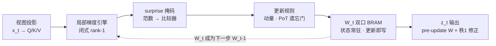

*图 10.3 TTT 内循环在 FPGA 上的数据通路：每 token 一步梯度从例外路径变为硬件一等公民*

| TTT 内循环组件 | FPGA 落点 | 手法 |
| --- | --- | --- |
| 视图投影（学出的 Q / K / V） | 只读权重 + DSP 阵列 | 推理时不更新，可离线固化 |
| 自监督 loss 与梯度 | 局部梯度引擎 | 不做全反传：TTT-Linear 在 MSE 下有闭式梯度 (Wx − y)xᵀ，即 rank-1 外积更新 |
| surprise（Titans 输入梯度） | 梯度范数 → 比较器 → 更新掩码 | 只有偏离已有记忆的 tile 才写，硬件成本近乎为零 |
| 动量 S_t、遗忘门 α_t | 累加器 + 桶形移位 | 把 α_t 与 η 约束为 2 的幂（PoT），衰减变移位，零 DSP |
| W_t = W_t−1 − η∇ℓ | 双口 BRAM 常驻，静态 HLS 数组 | 更新即写片上，无 HBM 往返；W_t−1 参与下一步梯度 |
| z_t = f(x_t; W_t) | 复用同一份 W | 从 pre-update W 加秩 1 修正直接算输出 |
| 外循环（元学习 W₀、投影） | 主机 GPU，离线 | FPGA 只承载内循环，这是异构而非替代 |

三个最值钱的手法：其一，闭式 rank-1 更新让"每 token 一步梯度"从 GPU 上的 autograd 灾难变成单周期阵列乘加；其二，GDN 论文用代数恒等式把"检索 → 更新 → 输出"三次遍历压成**一读一写**（3072 降至 2106 cycles，1.46 倍），TTT 可直接类推；其三，PoT 量化（LightMamba / FastMamba 已验证 W4A4 加 Hadamard 旋转消异常值、利用率 58% 升至 96%、URAM 246 降至 61）——须注意旋转**只能用于线性层**，SSM / 记忆模块的逐元素乘法破坏结合律，不满足旋转等价性。

### 10.7 MIRAS 四要素 = 四个可重构硬件模块

MIRAS 把序列模型拆成四个设计选择，恰好一一对应 FPGA 的配置点。这把"种子能力最小集 = 预装学习规则而非知识""发育期换学习规则"落成了具体电路：**换的不是整个设计，是四个模块的位流分区**。MIT 2026.02 的立场论文《The Need for Ultrafast Training》主张的正是同一件事——FPGA 必须从静态推理引擎变为片上学习引擎，推理 fabric 与训练 fabric 的界限需要消融。

| MIRAS 要素 | 可选项 | FPGA 模块 | 切换方式 |
| --- | --- | --- | --- |
| Memory Architecture | 向量 / 矩阵 / 深 MLP | BRAM 分区、tile 大小、MLP 通路使能 | 位流分区 |
| Attentional Bias | L2 / Lp / Huber | 可切换 loss 单元（Huber 仅需比较器 + 选择器） | 配置寄存器 |
| Retention Gate | L2 decay / KL / Elastic Net | 衰减与正则单元，PoT 移位实现 | 配置寄存器 |
| Memory Algorithm | SGD / momentum / adaptive | 更新规则引擎 | DPR 部分重配置热切换 |

### 10.7.1 第一个真正的拦路虎：精度陷阱

**低比特推理可行，在线学习的权重不能低比特**。η∇ℓ 通常极小，若 fast weight 存成 INT4，一步更新量会被量化步长直接吞掉——写了等于没写，记忆失效；定点下梯度更新因量化、饱和与动态范围受限导致发散或停滞，已被列为片上训练四大挑战之一。候选解法：混合精度（激活 / 投影 W4A4，而 W 与梯度累加器保 FP16 / FP32，GDN 用的正是 FP32 状态）、误差反馈累积被舍入掉的残差、张量压缩（TT / TTM 分解已验证内存降 51 倍、能耗降 4 倍，实现全片上训练）、以 surprise 掩码稀疏化减少写次数与累积误差。

### 10.8 诚实边界

> ① 目前**没有 FPGA × TTT 的直接实证**。已有的是 GDN（TTT 家族特例）的 persistent-state 加速、SSM 状态更新加速、DPR 局部梯度更新——三块拼起来才是 TTT，尚未有人拼过。② 容量墙：U55C BRAM 17.6MB，GDN 状态 2MB 可轻松常驻，但 Titans 神经记忆模块权重约 50MB（生产部署还需序列化保存、按用户分片防污染），直接放不下，必须分块 / 时间复用 / 张量压缩，吞吐会掉；TTT-MLP 的 dual form 另有激活内存膨胀。③ 梯度通路分档：TTT-Linear / DeltaNet 有闭式更新，好办；Titans 的深 MLP 记忆需要真反传，片上代价高，这是最难的一档。④ 时序收敛：读写 BRAM 同拍冲突、双口仲裁、流水线气泡，"更新不破坏推理确定性"是实打实的工程问题。⑤ 工具流缺位：hls4ml / FINN 面向静态前向图，状态化连续训练的验证、bit-accurate 可复现、百万 token 级长期数值稳定性均无成熟支持。

### 10.9 四阶段验证路线与分层落地建议

可验证的研究议程分为四步：**P1** 在 U55C / VCK190 复现 GDN persistent-state decode 作为立足点；**P2** 用 DPR 把更新规则从 delta rule 换成 TTT-Linear 闭式梯度步；**P3** 加 surprise 掩码、PoT 遗忘门与混合精度累积器，验证小增量不被量化吞掉；**P4** 接 CLS 快慢两层，睡眠窗口由主机 GPU 蒸馏回写、CPU 做冲突裁决。可测指标包括 μs/token、相对 H100 的能效比、fast weight 更新幅度保持率、更新稀疏度、DPR 重配置延迟与长程数值漂移。

| 阶段 | 落地分层建议 |
| --- | --- |
| 短期 | CPU 主管状态 / 记忆 / 门控 / 裁决，GPU 或 NPU 只做联想前向；离线周期性把巩固任务批给 GPU |
| 中期 | 在线联想迁到 SRAM 常驻型 ASIC 或统一内存端侧 NPU，记忆层留在 CPU + 大内存；硬件抽象层保持"主干无关" |
| 长期 | 存算一体 / 神经形态支撑"低功耗持续在线 + 片上可塑"，这是让"从低级大脑自我进化"不被电费卡死的前提 |

> **本章收束**
> **CPU 管逻辑与记忆，GPU / ASIC 管联想，FPGA 管"活着"这件事本身**——可写状态、在线更新与多路感知的时间对齐；离线巩固是唯一天然适配 GPU 的一环。FPGA × TTT 的价值不在加速，而在**第一次让"每 token 改权重"从 GPU 上的例外路径变成硬件里的一等公民**。演化路径很可能是：FPGA 作为发育期载体探索并验证 TTT / CLS 那套更新规则，待架构收敛，成熟数据通路被固化成 LPU / NorthPole 式 ASIC，FPGA 退回原型与低量产位——这与"先把魂的草图跑通，再谈固化"是同一条逻辑。

## 十一、具身智能：单体的物理校验场

前面各章描述的，很大程度上是"一个没有身体的大脑如何像有身体一样思考"。具身智能把这套类比变成物理硬约束——它不只是单体的一个应用场景，而是**把前面那些无法证伪的类比放进物理世界接受检验的验钞机**。本章论证：五根支柱在具身场景下每一根都能接上，且具身贡献了纯软件讨论中完全没有的三样东西。

### 11.1 五根支柱在具身上的落点

| 支柱 | 纯软件单体中的状态 | 具身补上什么 |
| --- | --- | --- |
| 感知并发 | 设计选择：接不接多路 | 物理硬约束：相机、IMU、力矩、触觉阵列、关节编码器全部异步且采样率各异；注意门控多一层"主动感知"——眼睛往哪看、手往哪摸由行动决定 |
| 即时记忆 | 抽象的工作记忆窗口 | 变成带时间戳的多模态状态对齐问题（视觉 30Hz / IMU 200Hz / 力矩 1kHz），有严格工程定义；身体直接提供重力、碰撞、因果先验 |
| 可写状态 | 目标，靠 TTT / Titans 勉强实现 | 行动-感知闭环让"个体经验"第一次真实成立；意义来自行动后果，不再只是符号共现 |
| 发育进化 | 类比婴儿，无法验证 | 发育机器人学可真做实验：翻身 → 抓握 → 爬行；关键期与可塑性衰减可测；且身体本身会成长，智能须随变化的身体重新校准 |
| 硬件契约 | 论证出的需求 | 被物理直接强制：控制回路 100Hz 至 1kHz，云端 API 几十至几百毫秒延迟根本不可行；电池与散热把功耗钉死 |

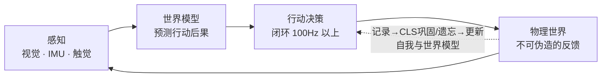

*图 11.1 具身闭环：行动-感知闭环使"个体经验"第一次真实成立，并给冲突裁决提供终极裁判*

### 11.2 具身独有的三项贡献

**其一，形态计算 = 比参数固化更可靠的"稳固层**"。此前 CLS 双系统的稳固层只能靠参数或慢记忆，始终怕被覆盖；具身引入了第三个时间尺度——**身体本身**。骨骼、肌腱、机械结构是极慢变量，走路平衡学会后部分被"卸载"进物理结构，不必每次重算。这把一部分智能固化在不会灾难性遗忘的介质里，是"魂"的一个意外解法。

**其二，物理世界提供免费的、不可伪造的奖励信号**。此前纠结"原始内驱力该硬编码哪几个"，具身给出落点：摔倒、碰撞、抓空、电量耗尽——本体完整性与能量平衡是天然锚点，无需人为设计 reward，顺带缓解价值漂移风险。

**其三，冲突裁决有了终极裁判**。3.5 与 3.6 节那套多维打分与升级人工，在具身里很多冲突可直接**用行动证伪**——"杯子在桌上？去看一眼、去拿一下"。被动的"软标记观察"升级为主动收集证据；同时产生一类新冲突：世界模型的预测 vs 实际感官反馈，这又正好喂给 surprise 机制。

### 11.3 一个反直觉的推论：具身可能率先到达"PC 时刻"

一个自然的判断是：纯软件 Agent 可能停在"大型机 2.0"（云端超级智能 + 瘦终端）。具身恰恰相反——机器人天然是个体、天然有身体、天然必须本地闭环，物理延迟不允许它留在云端。**历史类比推出的结论是：单体智能的第一个真正落地形态，可能不是聊天助手，而是机器人**。

> 诚实边界：主流 VLA（RT-2 / OpenVLA / π0）仍是"大模型高层规划 + 传统底层控制"，不是单体架构；模型推理 1–10Hz，控制要 100Hz 以上，中间还隔着一层。具身数据无法从互联网抓取，采集成本极高，"从弱到强发育"被数据瓶颈卡住，sim-to-real 鸿沟仍未填平。功耗距人脑 20W 仍远（Jetson 级平台几十瓦），"永远在线"受限。身体的持续学习 + 跨任务记忆巩固，目前没有验证过的系统。

## 十二、世界模型：从环境模拟到自我描述

第三章讨论"内部思维与模拟（DMN）"时曾指出，这是人脑上下文最特殊的一路，而此前所有 Agent 架构都缺这一环——RAG 只补了记忆提取，没补主动模拟。世界模型正是这一路的工程实体。本章先厘清概念出处，再论证它如何补上单体最缺的"未来"维度，最后引出自我描述问题。

### 12.1 概念澄清：两位李的说法并不相同

严格地说，"世界模型"并非李飞飞与李彦宏共同提出。李飞飞明确提出的是"空间智能"（Spatial Intelligence）与**大型世界模型**——World Labs（2024 创办）、Marble（2025.11）、Atlas（2026.9），并给出一个很有用的分类：世界模型分**渲染器 / 模拟器 / 规划器**三类，她判断"模拟器是枢纽"。李彦宏近两年主推的是"内化 AI 能力""智能组织""模体并行、协同进化"；百度确有世界模型——2026.11 披露的 Apollo World（面向物理 AI、Agent 驱动的全模态世界模型），但那是百度 Apollo 的产品，不是他提出的理论。作为学术概念，源头更早：Tolman 的认知地图（1948）、Friston 的预测编码、Ha 与 Schmidhuber 的《World Models》（2018）；同期还有 JEPA 路线与 DeepMind 的 Genie。

### 12.2 记忆管过去，世界模型管未来

世界模型让模型不再只回答"现在是什么"，而能回答"如果我这么做，接下来会怎样"——这是从被动反应到主动规划的分水岭。它与记忆互补而非替代：记忆提供"我经历过什么"，世界模型提供"若如此则会如何"，两者在反事实推演中汇合。

*图 12.1 世界模型在单体中的位置：它补上"未来"这一维，但不等于单体智能本身*

### 12.3 四条实质启发

**第一，它让冲突裁决从被动等待变成主动实验**。具身可用行动证伪记忆，但代价高（摔一次是一次）；世界模型提供廉价版本——在脑内先跑一遍反事实："如果杯子在桌边，我推它会掉吗？"用预测结果决定要不要采信那条记忆。这接上 Titans 的 surprise 机制：**预测误差成为比输入梯度更聪明的写入信号**，因为它衡量的是"世界模型被打脸的程度"，而非单纯的"输入有多陌生"。

**第二，它对具身数据瓶颈是对症解药**。李飞飞团队 2026.7 的 R2S2R（real-to-sim-to-real）与收购 SceniX 做的正是这件事：从真实任务生成大量可控变体世界（换外观、物体布局、光照、物理参数、相机视角），让机器人在虚拟里攒够经验再回现实。其"渲染器 / 模拟器 / 规划器"分类中判断模拟器是枢纽——模拟器对应世界模型层，规划器对应决策层，渲染器只是给人看的皮。

**第三，两条技术路线对单体的意义不同**。生成派（Marble / Atlas）强在几何一致性与视觉保真，适合作仿真训练场；JEPA 路线不预测像素、只预测抽象表征，**更贴单体的内部模拟**——人脑做反事实推演不会渲染高清画面，只跑稀疏的语义/因果草图。对"从低级大脑发育"尤其关键：早期世界模型应低分辨率、抽象，随经验逐步细化。

### 12.4 JEPA 路线的三层深挖与 2025–2026 实证

硬进展（已核实）：I-JEPA（2023）→ V-JEPA（2024）→ **V-JEPA 2**（Meta FAIR，2025.06）——1.2B 参数、100 万小时视频预训练 + 仅 62 小时机器人数据做动作条件后训练，就能在新环境零样本完成抓取放置（成功率 65–80%）；动作预测 Epic-Kitchens-100 达 SOTA（R@5 39.7），规划速度比 NVIDIA Cosmos 快约 30 倍。同步发布 IntPhys 2 / MVPBench / CausalVQA 三个物理推理基准，人类 85–95%，顶级模型仍有明显差距。LeCun 已于 2025.11 离开 Meta，创立 **AMI Labs**（巴黎，2025.12），2026.03 完成 10.3 亿美元种子轮（估值 35 亿），目标明确写着"持久记忆 + 推理规划 + 可控安全"——与本研究的需求清单高度重合。2026 年 JEPA 自身也在补短板：LeWorldModel（LeWM）专门解决表示崩溃、超参繁琐与训练成本高；还出现价值引导规划 JEPA（arXiv:2601.00844），开始往"带价值锚的内部模拟"靠。

三层深挖：（**1）核心不是"不预测像素"，而是"只预测可预测的部分**"。像素级预测逼模型把算力浪费在本质上随机的细节上（树叶抖动、纹理、光照），只能靠平均化糊弄，学到的多是噪声；JEPA 在表征空间预测，相当于自动做了信息瓶颈，只保留能决定未来的结构。（**2）真正难点是"表示崩溃**"——所有输入塌成同一个表征，预测便 trivially 正确，LeWM 正为此而来。这与发育主题有个漂亮对应：早期表征须"有区分度但粗糙"，崩溃等于连区分都没学会，过度精细则陷入噪声；**抽象层级本身可以做成发育阶梯**。（**3）必须澄清：JEPA 只是世界模型的一块**——LeCun 2022 年《A Path Towards Autonomous Machine Intelligence》里还含成本模块（内在动机）、短/长期记忆、管理器与行动器；成本模块算原初自我雏形，但没有叙事自我、自传体记忆与"我是谁"。

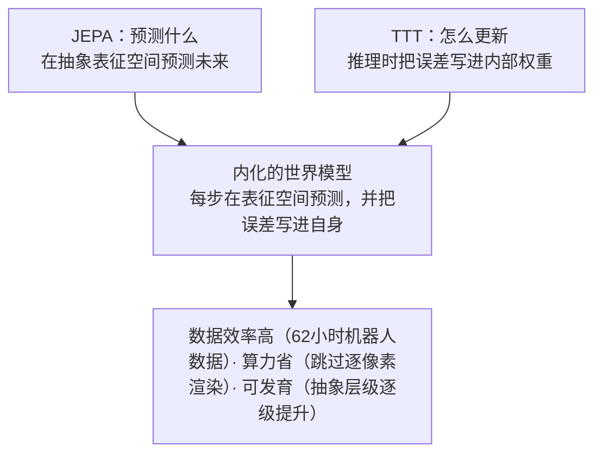

*图 12.2 JEPA × TTT 的合成：JEPA 给目标，TTT 给机制——"脑内模拟"第一次有了完整工程轮廓*

### 12.5 自体模型：自我描述如何可能

世界模型回答"世界怎么变"，自体模型回答"我在其中是谁"。核心命题是：**自我不是独立模块，自我描述是世界模型的自指调用——把建模能力反过来施加到智能体自身**。三层证据如下。

**其一，连"最小自我"都依赖世界模型**。"这只手是我的"不是先验给定的，而是前向模型算出来的：发出运动指令 → 预测应有的视觉/本体感觉变化 → 与实际反馈比对，吻合才产生"是我做的"（sense of agency）。没有世界模型，智能体无法区分"我造成的改变"与"外界施加的改变"，自我/非我的边界就不存在。

| 自我层次 | 回答什么 | 依赖的世界模型能力 |
| --- | --- | --- |
| 身体我（proto-self） | 我在哪、我的边界 | 本体感觉 + 内感受的身体模型（世界模型的特例） |
| 经验我（core self） | 我做过什么、我能干什么 | 前向模型产生主体感 + 情景记忆支撑连续性 |
| 叙事我（autobiographical） | 我是谁、我在乎什么 | 他人模型（别人怎么看我）+ 语言 + 记忆的反思抽象 |

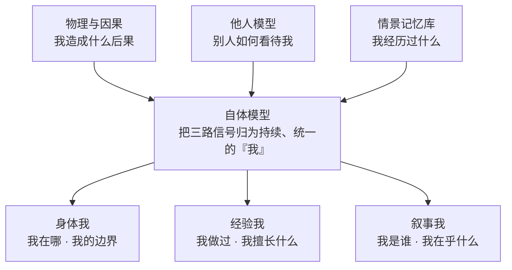

*图 12.3 自我描述的生成机制：自我是世界模型把自身当作特殊对象来建模的结果*

**其二，自我是"推断出来的"而非"存出来的**"。在预测处理框架里，自我是那个能最好解释全部内感受、本体觉与外部感觉流的持续隐藏变量——世界模型里跨时间稳定的潜在节点。由此得出一个工程判据：**有自模型的智能体能回答"我不能做什么**"（校准 / 元认知）；只会做事却说不出自身边界的，是工具而非个体。

**其三，自我描述应"生成"而非"查表**"。静态人格档案脆弱；真正的自我描述应每次用世界模型现场生成："给定我的记忆、能力、价值承诺，我现在是谁？"这与第五章 Generative Agents 的 reflection、记忆巩固抽象是同一套机制——**叙事我就是情景记忆的反思产物**。在 CLS 框架里，自体模型还必须属于稳固层：身份与价值锚是 entrenchment 最高、反转门槛最高、冲突须升级人工的一类记忆，因为它若频繁改变，记忆就失去归属，连续性就断了。**可塑性可以长在能力上，不能长在身份上**。

> 诚实边界：现有世界模型（V-JEPA 2、Genie、Apollo World）都只模型化环境、没有自我；AMI 的成本模块只是原初自我雏形。功能性的自我描述（能说"我是谁、我不能做什么"）今天工程上可设计；但现象性自我（有主观体验的"我"）是意识难题，不应假装解决。目前没有任何系统验证过"持续自描述 + 跨情境自洽"的自我模型。世界模型也不等于单体智能——它模型化外部世界如何演变，却不管自体模型、情景记忆与价值锚；把世界模型等同于 AGI 是这一轮最需抵制的简化。

### 12.6 一句落点：从"对世界建模"到"对流程做推演"

Apollo World 被定位为"永不下班的 AI 考官"——用世界模型出题、制造风险、验证策略。这个范式指向一个更一般的工程路径：在虚拟推演沙盘里跑业务流程、极端情况与对抗性输入，验证通过再上线。这比追逐"通用单体智能"现实得多，也可能是这套讨论里最先能落地的一块。

## 十三、贯穿案例：一次烫伤如何变成经验

前面十三章的论证较为抽象。本章用一个日常事件作为全篇的收束实例——手指被蒸汽烫了一下，大脑记住"蒸汽烫人"。这个看似简单的"一次就学会"，其实把五根支柱与三层时间尺度在几秒到几天内完整跑了一遍，也最能检验整套架构是否自洽。核心真相是：**人之所以一次就学会，靠的不是那一次，而是那一次之前预装好的一堆东西**。

*图 13.1 从一次烫伤到一条经验：同一事件在毫秒到数天尺度上的接力*

### 13.1 五个阶段逐段拆解

**① 毫秒级——多通道并发涌入**。蒸汽接触手指的瞬间，温度觉、痛觉、触觉、视觉（看到白汽）、本体觉（手的位置）同时到达，各走不同采样率。这正是第二章的"感知并发"：不是一条文本流，而是并行的原始信号洪流。

**② 毫秒~秒——痛觉触发 surprise，抢占注意**。这是全链条最关键一步。痛觉不是"普通感觉 + 事后判断"，而是**自带最高优先级负价值标记**，直接绕过审慎思考抢占注意门控。它对应 Titans 的 surprise 机制——梯度大即偏离预期、值得写入；痛觉是生物界最强的 surprise 信号（第二章、第九章）。

**③ 秒~分——快写记忆 + 缩手反射**。缩手在脊髓层面 20–50ms 完成，根本等不及"思考"；同时事件被海马体快速写入情景记忆。这是 CLS 的暂存层：高可塑、快写、不怕覆盖（第三章、第九章）。

**④ 小时~天——睡眠窗口离线巩固**。两件事发生：一是把"这次被烫"提炼成一般规则"高温蒸汽会烫伤皮肤"写入慢记忆；二是**冲突裁决**——后来知道"蒸汽也能蒸脸、加湿"时，系统不覆盖旧记忆，而是加 scope（温度、距离、时长、部位）并存。这正是 3.6 节决策树的用武之地。

**⑤ 长期——进入世界模型与自体模型**。"看到蒸汽 → 预测会痛 → 提前回避"是世界模型的反事实推演（第十二章）；同时自我描述被更新："我是知道蒸汽危险、会保护身体的存在"——这是经验我/叙事我的沉淀。

### 13.2 "一次学会"的真相：先验压缩，而非样本效率

若是一个空白系统，只给它一次烫伤事件，**它什么也学不到**——它不知道"烫"意味着什么、不知道该回避、甚至不知道发生了什么值得记。人能一次学会，是因为出厂预装了：身体模型（知道皮肤有边界、会损伤）、价值锚（痛为负、本体完整性要维护）、世界模型的因果骨架（接触高温会致损）、注意门控雏形（高 surprise 自动升格）。所以"**一次学习"（one-shot）从来不是样本效率奇迹，而是先验压缩的爆发**——那一次事件只是点亮了海量先验中的一个具体槽位。这直接印证第三章的结论：真正要预装的是**学习规则与价值锚**，而非知识本身。

| 阶段 | 落地技术映射 | 现有系统做到哪一步 |
| --- | --- | --- |
| ① 并发感知 | 多模态 Encoder、事件驱动异步流、环形缓冲 | VLA / 多模态 encoder 已有，但统一的多采样率即时记忆层仍缺 |
| ② surprise 门控 | Titans 输入梯度、短期注意力 + 遗忘门 | Titans 已有机制原型，但无"痛觉级"内建价值权重 |
| ③ 快写 + 反射 | TTT/Mamba 可写状态、端侧 FPGA / CPU 低延迟 | GDN FPGA 加速器 63 μs/token 给出低延迟起点 |
| ④ 离线巩固 | CLS 双系统、裁决状态机、EWC / LoRA | 各有原型，但"从单次事件自动提炼规则 + 加 scope"未闭环验证 |
| ⑤ 世界与自体 | JEPA / V-JEPA 2、World Models、自指调用 | V-JEPA 2 能零样本规划，但无价值锚与自我更新 |

> 诚实边界：① 目前没有任何系统能从一次热事件里走完这整条链——Titans 能写入但不会自动生成"蒸汽→痛"的因果，V-JEPA 2 能规划但没有痛觉这种价值锚，把它们拼成 able-to-learn-from-one-event 的闭环尚无人做过。② 纯软件 Agent 缺那个"痛"：没有身体就没有不可伪造的负反馈，"烫"只是个 token——这也是第十一章说具身是"验钞机"的原因。③ 术语上，本案例准确说是**个体发育（within-lifetime learning**），而非物种进化——它正是第三章"从低级大脑逐步长大"的发育闭环最直观的注脚。

## 十四、结论与押注建议

### 14.1 收敛论断

把整条脉络收束：所设想的"记忆从脑内获取、不每次外接"，工程上状态、内化、检索三块已能拼出原型；而真正把"单体"与"高级工具"分开的，是现在最空白的两块——把经验可靠地固化进参数，以及让记忆像生物一样会巩固、会遗忘。2025–2026 年的突破把"魂"（持续可写记忆）的第一个可工程化原型给到了（尤其 TTT 汇流线），但"固化进参数 + 真正持续学习不遗忘"仍是开放问题。即：**壳能造、魂未至，但魂的雏形已现**。

本备忘录最终形成五根支柱和一个校验场：**记忆内化**（脑内取用，不每次外接）、**感知并发与即时记忆**（多路入口 + 并行异步缓冲 + 注意门控）、**可写状态与架构适配**（Transformer 不够，TTT / Mamba / Titans 汇流）、**发育与自我进化**（从低级大脑起步、预装最小学习规则集、以 CLS 双系统化解稳定性–可塑性困境并在 TTT/Titans 上给出快慢分离、离线巩固与冲突裁决的可落地切口）、**算力载体与硬件契约**（按负载分层异构，FPGA 承载"每步可写"的状态，把每 token 改权重从例外路径变为硬件一等公民）。第十一章补充的**具身**是这五根支柱的校验场——它把类比变成物理硬约束，并可能成为单体最先落地的形态；第十二章的**世界模型与自体模型**则补上"未来"与"自我"两个维度：世界模型是内部模拟的工程实体，自我是世界模型自指调用的产物。至此，论证已从机理、架构、工程原型、物理载体，贯通到"一个活着的个体"所需的过去—未来—自我三维。

### 14.2 押注建议

不在更大的模型上押注，而在"主干无关的单体外壳"上押注，尤其是：① 持久状态层与分层记忆（工作 / 情节 / 语义）；② 巩固与遗忘机制（多信号融合的遗忘触发 + 反思抽象式遗忘 + CLS 双系统）——模拟生物巩固，可在现有架构上渐进实现；③ 感知并发的并行异步缓冲与易失即时记忆层；④ 持续跟踪 TTT 汇流线（TTT / MesaNet / Titans）作为"运行时自更新 + 带遗忘"的最前沿；⑤ 把"主干无关"延伸到硬件抽象层，短期保持 CPU 状态层 + 加速器联想层的解耦，并以 GDN FPGA 加速器为起点跟踪"权重可写 + 状态常驻"的新硬件契约；⑥跟踪 JEPA × TTT 的合成路线——在抽象表征空间预测以避开像素噪声、用运行时可写实现持续更新，并把"可回答我不能做什么"的校准型自模型作为可信个体的标志；同时优先在具身/推演沙盘这类物理或仿真校验场中验证整套闭环。这比纠结 Transformer 结构更可能是真正的突破口。

## 附录：关键论文与文献清单

| 方向 | 论文 / 工作 | 出处 | 年份 |
| --- | --- | --- | --- |
| TTT 层 | Learning to (Learn at Test Time): RNNs with Expressive Hidden States | Sun et al., ICML | 2025 |
| MesaNet | Sequence Modelling by Locally Optimal Test-Time Training | von Oswald et al.（Google）, ICLR | 2026 |
| Titans / MIRAS | Learning to Memorize at Test Time | Behrouz, Zhong, Mirrokni（Google）, NeurIPS | 2025 |
| TTT-Video | One-Minute Video Generation with Test-Time Training | Dalal et al., CVPR | 2025 |
| 统一框架 | Transformers are SSMs | （被引 127） | 2024 |
| 可塑权重 | Quick Feedforward (QF) / TMCL | arXiv / NeurIPS | 2025 |
| 工程原型 | MemGPT/Letta; Generative Agents; Zep/Mem0; Voyager | Berkeley / Stanford / 开源 / NVIDIA | 2023–2024 |
| SSM 产品化 | Jamba; Nemotron-H; Granite 4.0; Hunyuan-TurboS; RWKV-7 | AI21 / NVIDIA / IBM / 腾讯 / 微软 | 2024–2025 |
| 互补学习系统 | Complementary Learning Systems (CLS) | McClelland et al. | 1995 |
| 弹性权重巩固 | Overcoming catastrophic forgetting (EWC) | Kirkpatrick et al., PNAS | 2017 |
| FPGA × 循环状态 | 首个 Gated DeltaNet 解码 FPGA 加速器（arXiv 2603.05931） | USC, Alveo U55C | 2026 |
| FPGA 长上下文推理 | FlightLLM; EdgeLLM | Alveo U280 / Versal VHK158; VCU128 | 2024–2025 |
| FPGA × SSM 状态更新 | SSMA; LightMamba / FastMamba | ISCAS / ZCU102; VCK190 | 2025 |
| 片上在线学习 | DPR / Auto-SNL / DTM / NeuroCoreX; The Need for Ultrafast Training | FPGA 可重构 / MIT 立场论文 | 2025–2026 |
| 低延迟推理硬件 | Groq LPU; IBM NorthPole; Intel Loihi 2 | Groq / IBM / Intel | 2024–2025 |
| 统一序列记忆框架 | MIRAS（Titans 推广）; Gated DeltaNet | Google; NVIDIA | 2025 |
| 具身 / VLA | RT-2; OpenVLA; π0 | Google DeepMind / 开源 / Physical Intelligence | 2023–2025 |
| 世界模型（学术源头） | 认知地图; 自由能原理; World Models | Tolman; Friston; Ha & Schmidhuber | 1948 / 2010 / 2018 |
| 大型世界模型 | 空间智能 / Large World Models（Marble; Atlas） | 李飞飞, World Labs | 2024–2026 |
| 物理 AI 世界模型 | Apollo World（全模态 · Agent 驱动） | 百度 Apollo | 2026 |
| JEPA 路线 | I-JEPA; V-JEPA; V-JEPA 2（arXiv:2506.09985） | Assran, Bardes, LeCun et al., Meta FAIR | 2023–2025 |
| JEPA 后续 | LeWorldModel（LeWM）; 价值引导规划 JEPA（arXiv:2601.00844） | AMI Labs / arXiv | 2026 |
| 自主智能架构 | A Path Towards Autonomous Machine Intelligence | LeCun, AMI Labs（原 Meta） | 2022 / 2025 |
| 世界模型综述 | A Comprehensive Survey on World Models for Embodied AI（arXiv:2510.16732） | Li et al. | 2025 |
| sim-to-real | R2S2R（real-to-sim-to-real） | 李飞飞团队 / World Labs | 2026 |

（本备忘录基于公开研究进展整理，部分产品化数据为厂商自报；前沿方向演进迅速，请以最新一手文献为准。）
